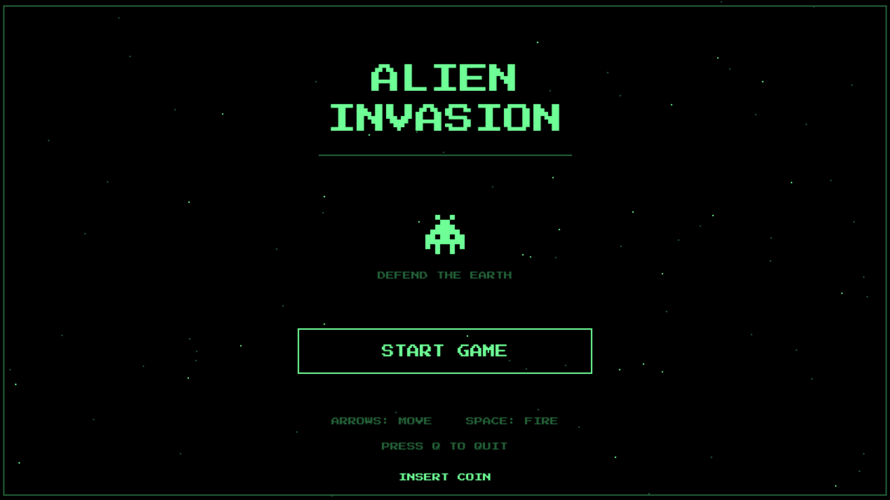
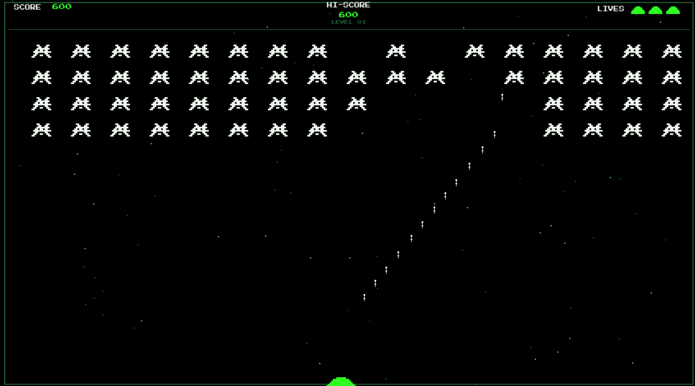

# Alien Invasion – Retro Arcade Game 👾👾👾

A classic arcade-style Alien Invasion game built using **Python and Pygame**, inspired by the Alien Invasion project in Eric Matthes' *Python Crash Course*.

What started as a hands-on Python learning project gradually evolved into a nostalgic arcade game, featuring pixel-art sprites, a monochrome green aesthetic, animated aliens, and a retro-inspired interface.

## Screenshots

### Main Menu


### Gameplay


## Tech Stack

| Technology | Purpose |
|---|---|
| Python | Core programming language |
| Pygame | Game development, graphics, input handling, and collision detection |
| Git & GitHub | Version control and project management |

## Getting Started

### Prerequisites

- Python 3.x
- Pygame

### Installation

1. Clone the repository:

   ```bash
   git clone https://github.com/thanmayee-shetty/alien.git
   ```

2. Navigate to the project directory:

   ```bash
   cd alien
   ```

3. Install Pygame:

   ```bash
   pip install pygame
   ```

4. Run the game:

   ```bash
   python alien_invasion.py
   ```

## Controls

| Key | Action |
|---|---|
| ← Left Arrow | Move spaceship left |
| → Right Arrow | Move spaceship right |
| Spacebar | Fire bullets |
| Enter | Start the game |
| Q | Quit the game |

## Project Structure

```text
alien/
│
├── alien_invasion.py
├── settings.py
├── alien.py
├── ship.py
├── bullet.py
├── game_stats.py
├── scoreboard.py
├── retro_background.py
├── retro_menu.py
│
├── images/
│
└── assets/
    └── fonts/
        └── PressStart2P-Regular.ttf
```

## Inspiration & Credits 🤸‍♀️🤸‍♀️🤸‍♀️

This project was inspired by **Python Crash Course: A Hands-On, Project-Based Introduction to Programming** by **Eric Matthes**, particularly Project 1: Alien Invasion (Chapters 12–14).

The book provided the foundation for learning Pygame, object-oriented programming, sprite management, collision detection, and game mechanics.

- **Author:** [Eric Matthes](https://github.com/ehmatthes)
- **Official book resources:** [Python Crash Course – GitHub Repository](https://github.com/ehmatthes/pcc_2e)
- **Book:** [Python Crash Course](https://nostarch.com/python-crash-course-3rd-edition)

The original learning project was extended with a custom retro arcade interface, pixel-art sprites, animations, and visual improvements.

This repository represents my own implementation and customizations built while learning from the book.

---

*Built as a learning project and a little tribute to classic arcade games.*
